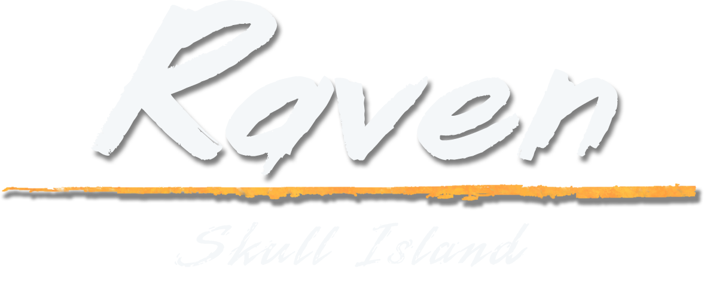
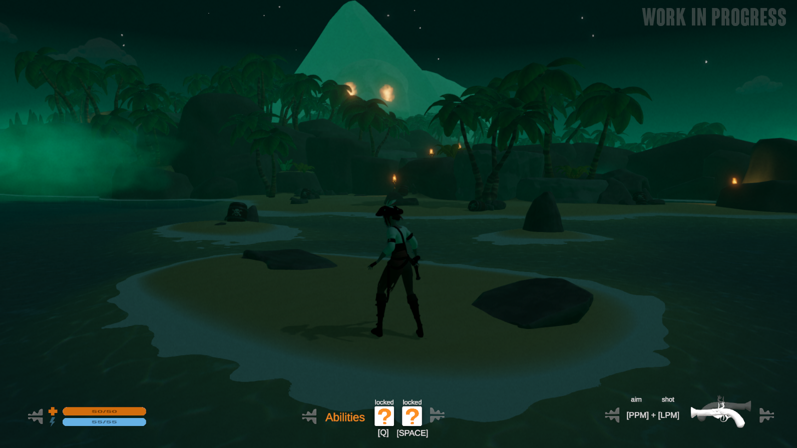
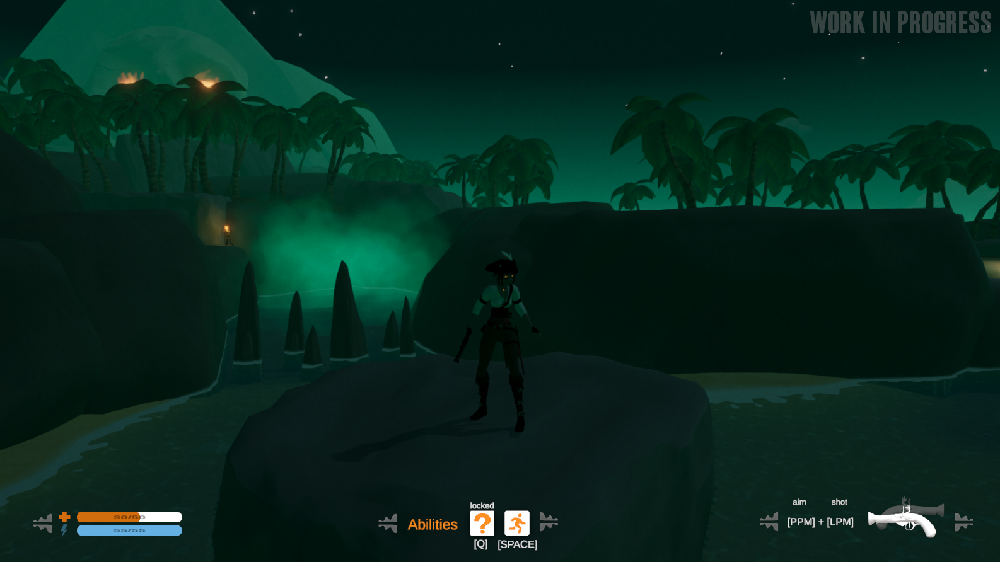
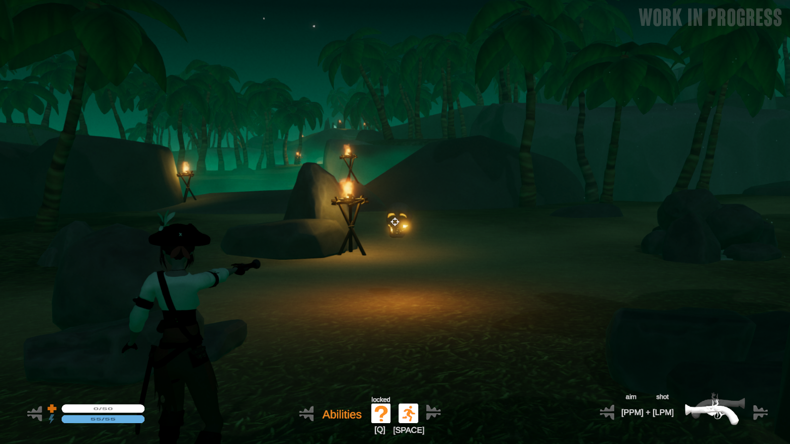
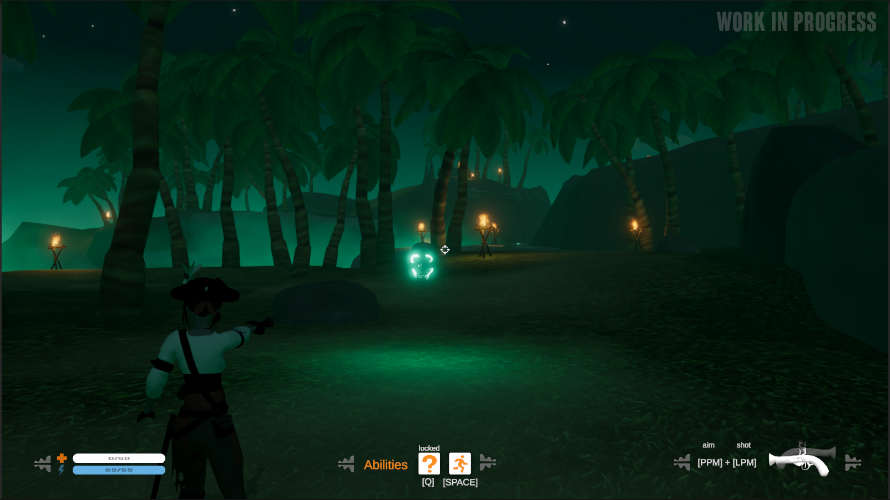
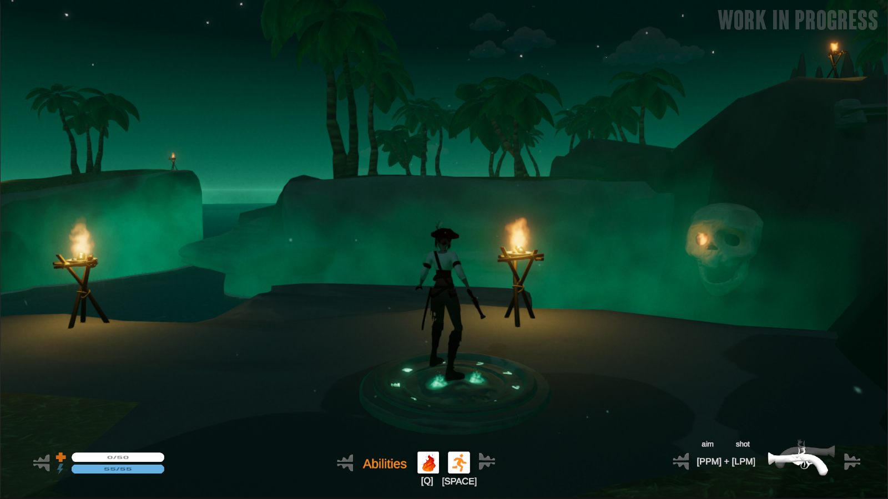
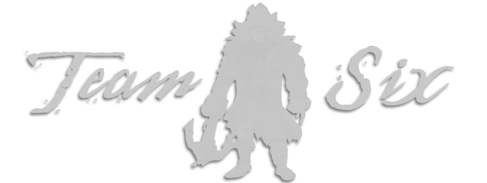

  

<b>Survive the island. Uncover the curse.</b> 
A third-person pirate adventure with exploration, combat and puzzles on a haunted island.

  
  
  

  <a href="README.pl.md">Polski</a> · <b>English</b> ·
  <a href="#quick-start">Quick start</a> · <a href="#screenshots">Screenshots</a> ·
  <a href="#highlights">Features</a> · <a href="#controls">Controls</a> ·
  <a href="#for-developers">For developers</a> · <a href="#team-and-authorship">Team & credits</a>

**Raven: Skull Island** follows a young pirate who survives a shipwreck, only to find herself bound to a cursed island. The souls of long-dead pirates linger as haunted skulls. Explore the island, face its mysteries and fight to escape before the curse consumes you.

Originally a six-person graduation project at **Game Dev School**, Raven is now continued and modernized by **Daniel Pytel**.

## Quick start

1. Download **[initial-release.zip](https://github.com/danielmaciejpytel/raven/releases/download/initial-release/initial-release.zip)** from the [original graduation release](https://github.com/danielmaciejpytel/raven/releases/tag/initial-release).
2. Extract the entire archive, keeping its folders together.
3. Launch the game's executable from the extracted folder.

This is the **archived 2021 graduation build**. It preserves the original team's submission, including its unfinished features and bugs; it does not contain the later modernization work. You do not need Unity to play the archived build. To work with the current project, see [For developers](#for-developers).

## Screenshots

Work-in-progress captures from the project.

| Island exploration | Aiming and combat |
|:---:|:---:|
|  |  |

| Environment | Gameplay |
|:---:|:---:|
|  |  |

[Watch the original graduation-project recording](https://www.youtube.com/watch?v=zeqDeDUHbcQ).

## Highlights

- **A cursed pirate island** — explore a stylized environment shaped by shipwrecks, haunted skulls and the mystery surrounding Raven's survival.
- **Third-person exploration** — move through the island with a following camera, discover paths and interact with the world.
- **Combat and abilities** — aim and fire Raven's weapons, unlock a dash and switch to the fire state as progression permits.
- **Puzzles and discovery** — solve environmental challenges and collect items that open up further gameplay possibilities.
- **A continuing revival** — the original environments, artwork, atmosphere and core ideas are being preserved while their underlying systems are improved.

## Controls

The current project's input bindings are listed below. The archived graduation build may differ; abilities depend on their unlock state.

| Action | Keyboard / Mouse | Xbox-style gamepad binding |
| --- | --- | --- |
| Move | `WASD` | Left stick |
| Camera | Mouse | Right stick |
| Aim | `RMB` | `LB` |
| Shoot while aiming | `LMB` | `X` |
| Dash, once unlocked | `Space` | `A` |
| Switch normal / fire state, once unlocked | `Q` | `Y` |
| Collect / take | `E` | `B` |
| Pause / menu | `Esc` | — |

## Continuing development

All work after the original submission — including fixes, visual improvements, engine upgrades, design changes, restructuring and restored or reworked features — is solo development by **Daniel Pytel**.

The current project targets **Unity 6**, with **URP**, the **Unity Input System**, **Cinemachine 3** and **Animation Rigging**. Modernization covers legacy gameplay and UI, camera controls and tracking, rendering, materials, lighting, performance and project structure.

The long-term direction is to refine the existing game while preserving its identity: improve encounters, interactions and puzzles; revisit unfinished systems; restore or redesign features such as melee combat and boss encounters; and expand the island with new areas and narrative elements. These are development goals, not a list of completed features.

## For developers

### Open the current project

1. Clone this repository.
2. Install the **Unity Editor version recorded in [`ProjectSettings/ProjectVersion.txt`](ProjectSettings/ProjectVersion.txt)** for the revision you cloned.
3. Add the repository folder to Unity Hub and open it with that editor version.
4. Let Unity restore packages and finish importing the project.
5. Open **`Assets/Scenes/Level.unity`**, the enabled scene in Build Settings, and enter Play Mode.

The archived download and the current source project represent different stages of development. Do not use the archived release as evidence that the current revision has passed a player-build or runtime test.

<b>Technology and maintenance notes</b>

| Component | Project configuration |
| --- | --- |
| Unity Editor | See [`ProjectSettings/ProjectVersion.txt`](ProjectSettings/ProjectVersion.txt) |
| Universal Render Pipeline | `17.3.0` |
| Input System | `1.20.0` |
| Cinemachine | `3.1.7` |
| Animation Rigging | `1.4.1` |
| Localization | `1.5.13` |

Package versions are defined in `Packages/manifest.json` and `Packages/packages-lock.json`.

`StartRavenUnity.cmd` contains a machine-specific editor path. Use Unity Hub with the editor version recorded in the project when opening the source on another computer.

## Team and authorship

### Continuing development — Daniel Pytel

**Since completing the Game Dev School course, Daniel Pytel has independently continued work on Raven and remains its sole developer and maintainer today.**

All subsequent bug fixes, engine and package upgrades, camera and input improvements, visual updates, project restructuring, and restored or reworked gameplay features are his solo work. He continues to develop, modernize and expand the game while preserving its original identity.

### Original graduation team

  

The original game was created by a six-person team as a **Game Dev School graduation project**:

| Role | Contributor |
| --- | --- |
| Programming | Patryk Niewiarowski |
| Lead Artist | Daniel Pytel |
| Additional Art | Marcin Świgut |
| Game Design | Andrzej Kula, Wojciech Nikorowicz, Łukasz Lampka |
| Project Mentor | Andrzej Zawadzki, former Lead Gameplay Designer at CD PROJEKT RED |

The initial commit preserves the submitted project state. The original team's contributions and the project's graduation history remain part of Raven's authorship.
