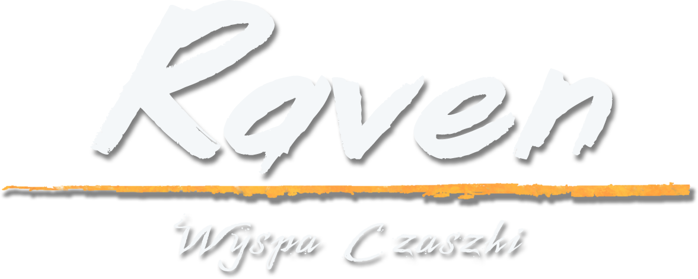
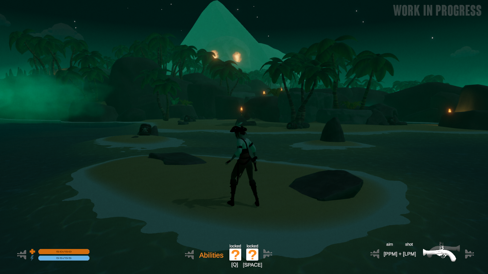
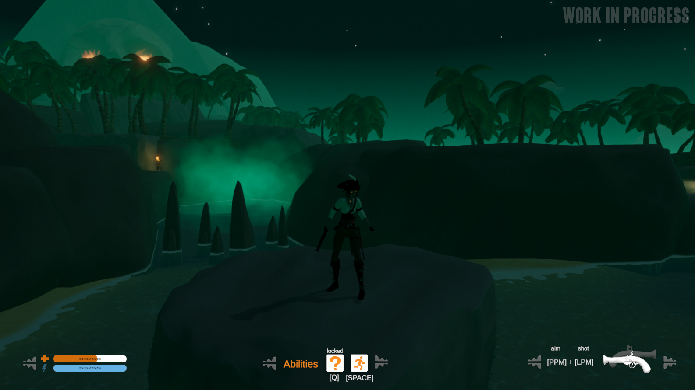
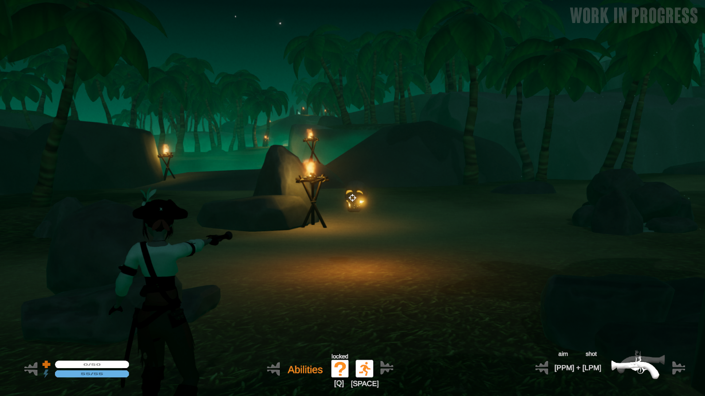
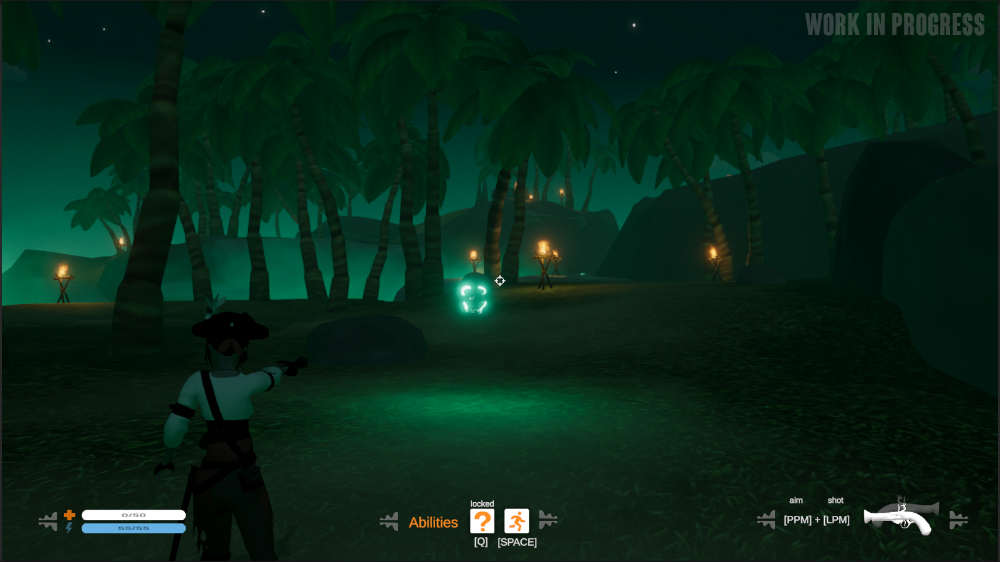
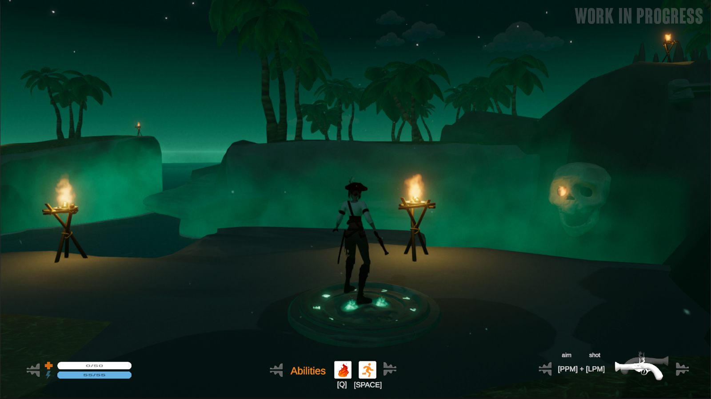
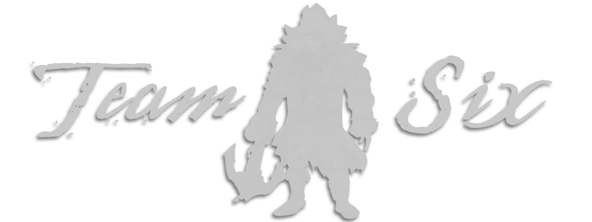

  

<b>Przetrwaj na wyspie. Odkryj tajemnicę klątwy.</b> 
Piracka przygoda z perspektywy trzeciej osoby: eksploracja, walka i zagadki na nawiedzonej wyspie.

  
  
  

  <b>Polski</b> · <a href="README.md">English</a> ·
  <a href="#szybki-start">Szybki start</a> · <a href="#zrzuty-ekranu">Zrzuty ekranu</a> ·
  <a href="#funkcje">Funkcje</a> · <a href="#sterowanie">Sterowanie</a> ·
  <a href="#dla-programistów">Dla programistów</a> · <a href="#zespół-i-autorstwo">Zespół i autorstwo</a>

**Raven: Wyspa Czaszki** opowiada o młodej piratce, która ocalała z katastrofy statku, lecz została związana klątwą z tajemniczą wyspą. Dusze dawno zmarłych piratów wciąż błąkają się tu jako nawiedzone czaszki. Zbadaj wyspę, odkryj jej sekrety i spróbuj uciec, zanim klątwa pochłonie Raven.

Gra powstała jako sześcioosobowy projekt dyplomowy **Game Dev School**. Obecnie rozwija ją i modernizuje samodzielnie **Daniel Pytel**.

## Szybki start

1. Pobierz **[initial-release.zip](https://github.com/danielmaciejpytel/raven/releases/download/initial-release/initial-release.zip)** z [oryginalnego wydania dyplomowego](https://github.com/danielmaciejpytel/raven/releases/tag/initial-release).
2. Rozpakuj całą paczkę, zachowując jej strukturę folderów.
3. Uruchom plik wykonywalny gry z rozpakowanego folderu.

To **archiwalny build dyplomowy z 2021 r.** Zachowuje projekt pierwotnego zespołu wraz z ówczesnymi błędami i niedokończonymi funkcjami; nie zawiera późniejszej modernizacji. Do uruchomienia tego buildu nie potrzebujesz Unity. Pracę z obecnym projektem opisuje sekcja [Dla programistów](#dla-programistów).

## Zrzuty ekranu

Zrzuty z prac nad projektem.

| Eksploracja wyspy | Celowanie i walka |
|:---:|:---:|
|  |  |

| Otoczenie | Rozgrywka |
|:---:|:---:|
|  |  |

[Zobacz nagranie oryginalnego projektu dyplomowego](https://www.youtube.com/watch?v=zeqDeDUHbcQ).

## Funkcje

- **Przeklęta piracka wyspa** — eksploruj stylizowane otoczenie, wraki i nawiedzone czaszki, poznając tajemnicę ocalenia Raven.
- **Eksploracja w trzeciej osobie** — przemierzaj wyspę z kamerą podążającą za postacią, odkrywaj ścieżki i wchodź w interakcje z otoczeniem.
- **Walka i zdolności** — celuj i strzelaj, odblokuj dash oraz przełączaj zwykły i ognisty stan postaci w miarę postępów.
- **Zagadki i odkrywanie** — rozwiązuj wyzwania środowiskowe i zbieraj przedmioty otwierające kolejne możliwości rozgrywki.
- **Dalszy rozwój oryginalnej gry** — modernizacja zachowuje pierwotne lokacje, grafikę, atmosferę i główne pomysły, poprawiając ich podstawy techniczne.

## Sterowanie

Poniżej znajdują się przypisania obecnego projektu. Archiwalny build dyplomowy może się różnić; dostępność zdolności zależy od ich odblokowania.

| Czynność | Klawiatura / mysz | Przypisanie pada Xbox |
| --- | --- | --- |
| Ruch | `WASD` | Lewy drążek |
| Kamera | Mysz | Prawy drążek |
| Celowanie | `PPM` | `LB` |
| Strzał podczas celowania | `LPM` | `X` |
| Dash, po odblokowaniu | `Spacja` | `A` |
| Zmiana stanu zwykłego / ognistego, po odblokowaniu | `Q` | `Y` |
| Zbieranie / podnoszenie | `E` | `B` |
| Pauza / menu | `Esc` | — |

## Dalszy rozwój

Wszystkie zmiany po pierwotnym oddaniu projektu — poprawki błędów, ulepszenia grafiki, aktualizacje silnika, zmiany projektu rozgrywki, porządki oraz przywracanie i przebudowa funkcji — są samodzielną pracą **Daniela Pytla**.

Obecny projekt jest rozwijany w **Unity 6**, z **URP**, **Unity Input System**, **Cinemachine 3** i **Animation Rigging**. Modernizacja obejmuje starsze systemy rozgrywki i UI, sterowanie kamerą i śledzenie postaci, rendering, materiały, oświetlenie, wydajność oraz strukturę projektu.

Dalszy kierunek to dopracowanie istniejącej gry z zachowaniem jej tożsamości: poprawa starć, interakcji i zagadek, powrót do niedokończonych systemów, przywrócenie lub przeprojektowanie walki wręcz i bossów oraz rozbudowa wyspy o nowe obszary i elementy fabuły. Są to cele rozwoju, a nie lista ukończonych funkcji.

## Dla programistów

### Otwieranie obecnego projektu

1. Sklonuj repozytorium.
2. Zainstaluj **wersję Unity zapisaną w [`ProjectSettings/ProjectVersion.txt`](ProjectSettings/ProjectVersion.txt)** dla sklonowanej rewizji.
3. Dodaj folder repozytorium do Unity Hub i otwórz go w tej wersji edytora.
4. Poczekaj na odtworzenie pakietów i zakończenie importu projektu.
5. Otwórz **`Assets/Scenes/Level.unity`**, scenę włączoną w Build Settings, i przejdź do Play Mode.

Archiwalna paczka i obecne źródła przedstawiają różne etapy rozwoju gry. Działanie starego wydania nie potwierdza zaliczenia buildu ani testu rozgrywki bieżącej rewizji.

<b>Technologie i informacje techniczne</b>

| Składnik | Konfiguracja projektu |
| --- | --- |
| Edytor Unity | Zobacz [`ProjectSettings/ProjectVersion.txt`](ProjectSettings/ProjectVersion.txt) |
| Universal Render Pipeline | `17.3.0` |
| Input System | `1.20.0` |
| Cinemachine | `3.1.7` |
| Animation Rigging | `1.4.1` |
| Localization | `1.5.13` |

Wersje pakietów określają `Packages/manifest.json` i `Packages/packages-lock.json`.

`StartRavenUnity.cmd` zawiera ścieżkę edytora właściwą dla konkretnego komputera. Na innym komputerze otwieraj źródła przez Unity Hub w wersji zapisanej w projekcie.

## Zespół i autorstwo

### Dalszy rozwój — Daniel Pytel

**Od zakończenia kursu Game Dev School Daniel Pytel samodzielnie kontynuuje pracę nad Raven i pozostaje jedyną osobą rozwijającą oraz utrzymującą projekt także obecnie.**

Wszystkie późniejsze poprawki błędów, aktualizacje silnika i pakietów, ulepszenia kamery i sterowania, zmiany graficzne, porządki w projekcie oraz przywracanie i przebudowa funkcji rozgrywki są jego samodzielną pracą. Nadal rozwija, modernizuje i rozbudowuje grę, zachowując jej pierwotną tożsamość.

### Pierwotny zespół dyplomowy

  

Pierwotna gra powstała jako **projekt dyplomowy Game Dev School**, wykonany przez sześcioosobowy zespół:

| Rola | Autor |
| --- | --- |
| Programowanie | Patryk Niewiarowski |
| Główny artysta | Daniel Pytel |
| Pozostałe prace graficzne | Marcin Świgut |
| Game design | Andrzej Kula, Wojciech Nikorowicz, Łukasz Lampka |
| Mentor projektu | Andrzej Zawadzki, były Lead Gameplay Designer w CD PROJEKT RED |

Pierwszy commit zachowuje stan oddany do oceny. Dorobek pierwotnego zespołu i dyplomowe początki pozostają częścią autorstwa Raven.
